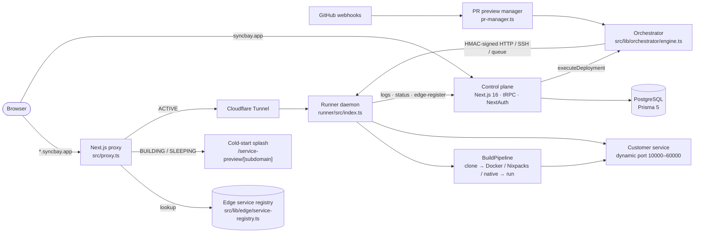

# Syncbay — Hybrid Compute PaaS

> Push a repo, get a live `https://<service>.syncbay.app`. Syncbay is a Vercel/Railway-class platform. Its control plane runs on Vercel, and builds and runtimes run on any Linux host you attach.

## Architecture



| Layer | Technology |
| --- | --- |
| Control plane | Next.js 16.3 App Router, React 19, TypeScript strict |
| API | tRPC 11 + React Query 5 + superjson; REST `/api/v1` with OpenAPI |
| Auth | NextAuth v4: Google, GitHub (repo scope), email/password |
| Data | Prisma 5, PostgreSQL |
| Runner | Node 20 daemon (`runner/`): Docker, Nixpacks or native processes |
| Ingress | Cloudflare Tunnels, Next.js proxy, edge service registry |
| Email | Resend + React Email |

See [`CLAUDE.md`](./CLAUDE.md) for a module-by-module map.

## Getting started

```bash
npm install                       # also runs prisma generate
cp .env.example .env.local        # fill in DATABASE_URL, NEXTAUTH_SECRET, OAuth keys
npx prisma migrate dev            # apply migrations
npm run dev                       # http://localhost:3000
```

Run a local runner so deploys execute on your machine:

```bash
cd runner && npm install
RUNNER_SECRET=dev-secret SYNCBAY_API_URL=http://localhost:3000 npm start   # :8080
# in the control plane .env.local:  RUNNER_URL=http://localhost:8080  RUNNER_SECRET=dev-secret
```

If `RUNNER_URL` is unset, deployments run in-process through `LocalRunnerDriver`. On Vercel they fall back to the simulated executor.

### Quality gates

```bash
npx prisma generate && npm run typecheck && npm run knip && npm run lint && npm run build
cd runner && npm run build && npm test
```

### OAuth callback URLs
Register these redirect URIs with each provider (Google: "Authorized redirect URIs" on the OAuth client; GitHub: "Authorization callback URL" on the OAuth app).

| Environment | Google | GitHub |
| --- | --- | --- |
| Production | `https://syncbay.app/api/auth/callback/google` | `https://syncbay.app/api/auth/callback/github` |
| Vercel preview | `https://<preview-origin>/api/auth/callback/google` | `https://<preview-origin>/api/auth/callback/github` |
| Local dev | `http://localhost:3000/api/auth/callback/google` | `http://localhost:3000/api/auth/callback/github` |

- Previews: providers match redirect URIs exactly, with no wildcards. Either register each preview origin, or give previews a stable branch domain (for example `https://staging.syncbay.app`, set as `NEXTAUTH_URL` for the Preview environment) and register only that one.
- A GitHub OAuth app accepts only one callback URL. Use a separate OAuth app for previews and for local dev.
- After sign-in, the `redirect` callback in `src/lib/auth.ts` accepts only these targets: `https://syncbay.app`, `https://*.syncbay.app`, and the current deployment origin (`VERCEL_URL`, `VERCEL_BRANCH_URL`, `VERCEL_PROJECT_PRODUCTION_URL`).

### Database migrations
Production deploys migrate automatically. Vercel runs `npm run vercel-build` (`scripts/vercel-build.mjs`), which on `VERCEL_ENV=production` runs `prisma migrate deploy` before `next build`.
- It uses `DIRECT_URL` if set, otherwise `DATABASE_URL`.
- A failed migration stops the build, so the previous deployment keeps serving.
- A database that was never baselined (P3005) stops the build with the exact `prisma migrate resolve` steps.
- Preview builds never touch the database.
- Set `SKIP_DB_MIGRATE=1` to bypass.

### Self-host the runner (Alibaba Cloud ECS / any VPS)
`deploy/alibaba-ecs/` runs the runner plus Caddy with automatic HTTPS on one server with a public IP, with no tunnel needed. See [`deploy/alibaba-ecs/README.md`](./deploy/alibaba-ecs/README.md). Set `RUNNER_URL=https://runner.syncbay.app` and the same `RUNNER_SECRET` in Vercel.

## Environment variables

`.env.example` is the source of truth. These are the main variables:

| Variable | Required | Purpose |
| --- | --- | --- |
| `DATABASE_URL` / `DIRECT_URL` | yes | PostgreSQL connection (pooled / direct for migrations) |
| `NEXTAUTH_URL` / `NEXTAUTH_SECRET` | yes | NextAuth base URL and JWT secret |
| `GOOGLE_CLIENT_ID` / `GOOGLE_CLIENT_SECRET` | for Google sign-in | Google OAuth |
| `GITHUB_CLIENT_ID` / `GITHUB_CLIENT_SECRET` / `GITHUB_WEBHOOK_SECRET` | for GitHub sign-in and deploys | GitHub OAuth app and webhooks |
| `RESEND_API_KEY` / `EMAIL_FROM` | optional | Transactional email (logged to the console when unset) |
| `RUNNER_DRIVER` | optional | `webhook`, `ssh`, `queue`, `local` or `mock` |
| `RUNNER_URL` / `RUNNER_SECRET` | for remote compute | Runner daemon endpoint and HMAC secret |
| `UPSTASH_REDIS_REST_URL` / `UPSTASH_REDIS_REST_TOKEN` | recommended in prod | Persistent L2 store for edge routes |
| `CLOUDFLARE_ACCOUNT_ID` / `CLOUDFLARE_API_TOKEN` / `CLOUDFLARE_ZONE_ID` / `CLOUDFLARE_TUNNEL_ID` | for custom domains and tunnels | Cloudflare API |
| `NEXT_PUBLIC_APP_URL` | optional | Public base URL used in links and emails |

## Roadmap

See [`ROADMAP.md`](./ROADMAP.md).

- [x] Core deploy loop: GitHub → build → deploy → domain → logs
- [x] Hybrid runner drivers and standalone runner daemon
- [x] PR preview environments with scale-to-zero
- [x] Cloudflare tunnel and custom-domain ingress
- [x] v1.0 baseline: knip gate, runner build, lint at 0 errors
- [x] Persistent two-tier edge registry and `proxy.ts`
- [x] Hardened runner fabric and tunnel reload
- [x] Managed Postgres/Redis and web terminal
- [x] GitHub Actions CI and env validation
- [x] v1.1: durable deploys, persistent logs/metrics/usage, scale-to-zero, Stripe + R2, DB-backed WAF/cron/canary, real Query Studio
