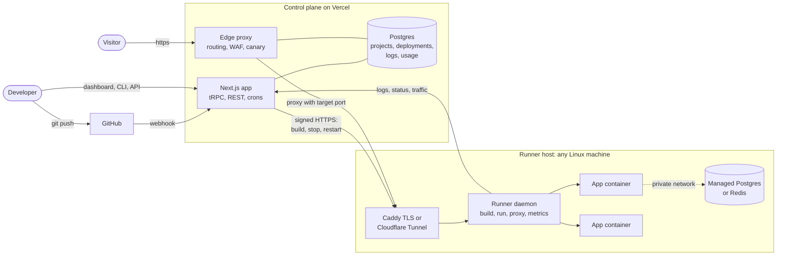
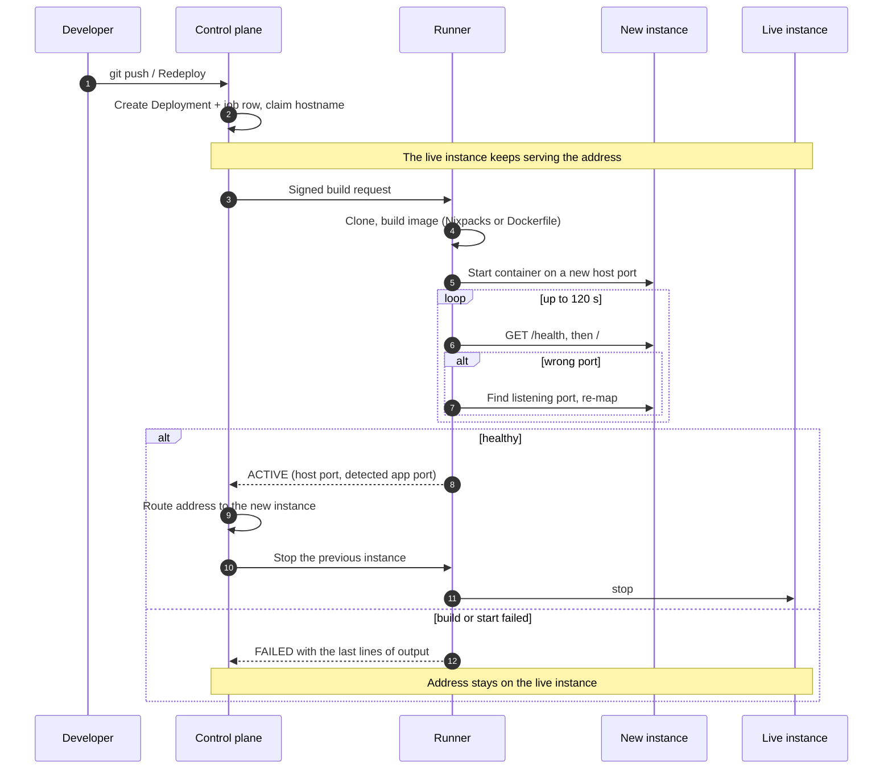
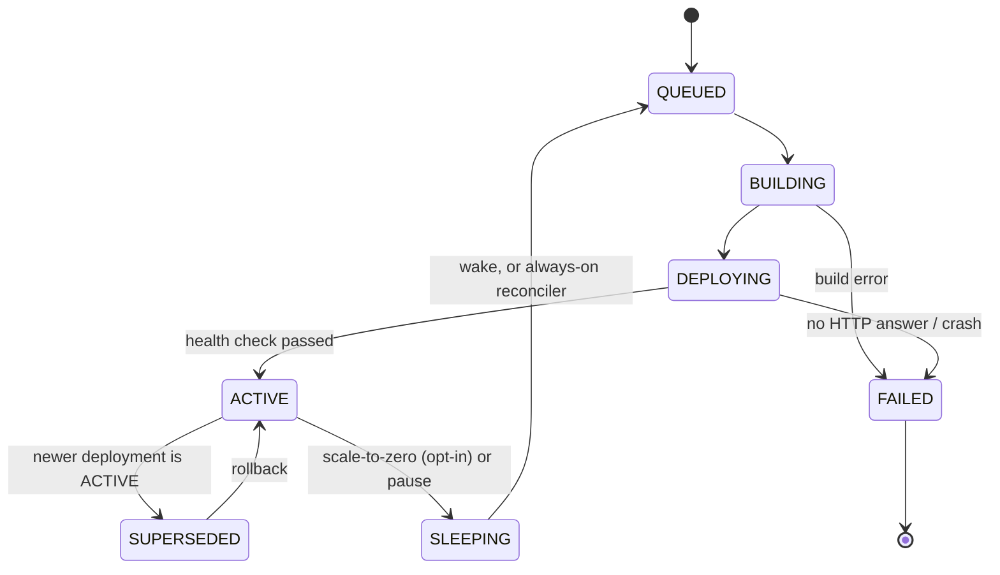
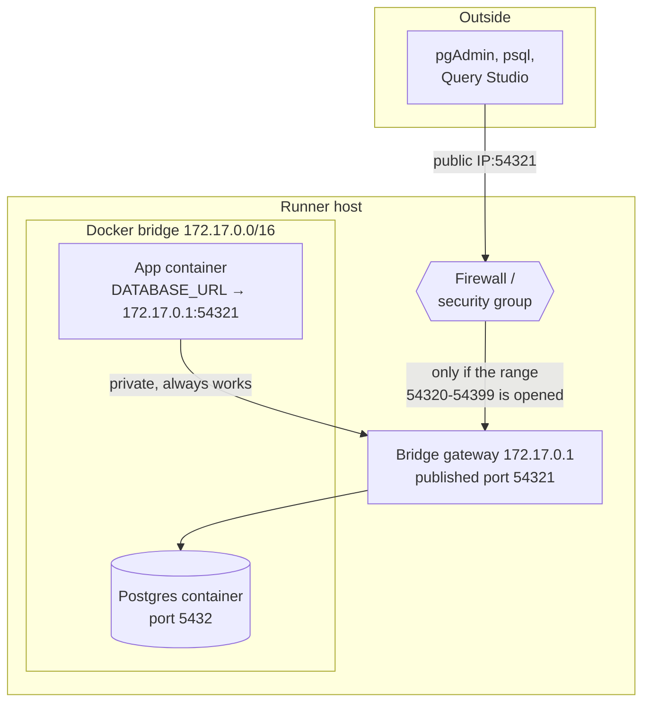
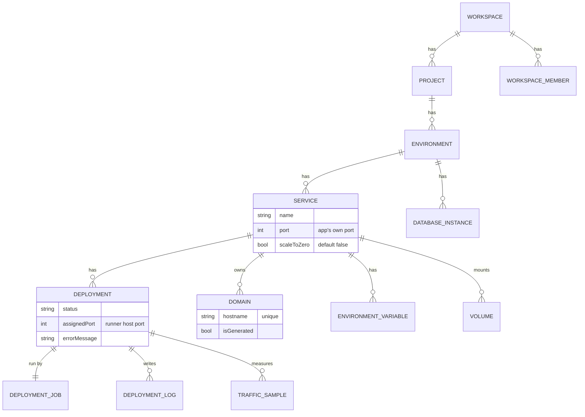
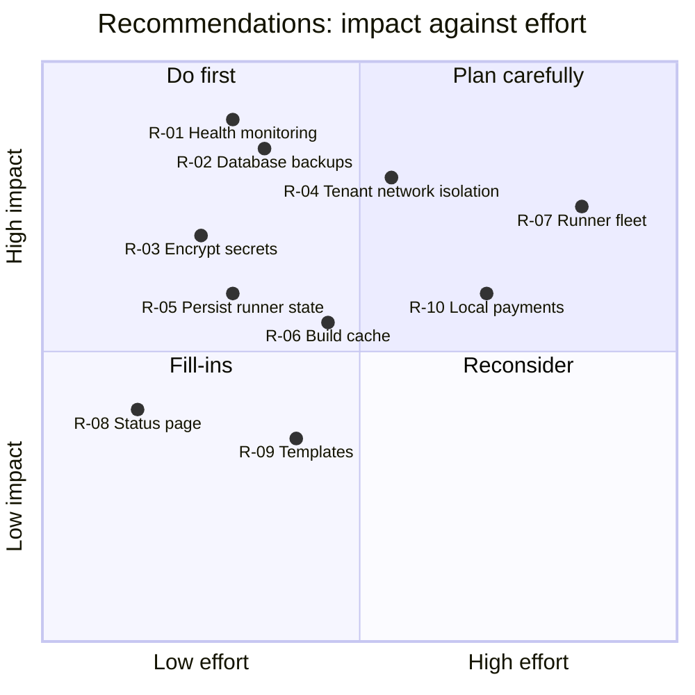
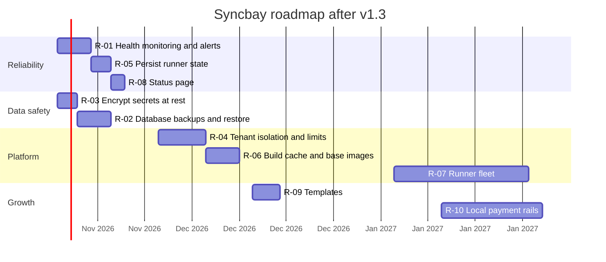

# Syncbay — Product Requirements Document

**Version 1.3 · 11 November 2026 · MSNS-DEV**
Supersedes *Portway PRD v0.1* (2 September 2026). The product was renamed **Syncbay** (`syncbay.app`).

| Version | Date | Change |
| --- | --- | --- |
| 0.1 | 2 Sep 2026 | Initial draft under the working name Portway: scope, requirements, Cloudflare Containers data plane |
| 1.1 | Oct 2026 | Backend made real: durable deploys, logs, metrics, usage, billing, managed databases |
| 1.2 | Nov 2026 | Self-hosted runner in production, runner preflight, project actions, live analytics |
| **1.3** | **11 Nov 2026** | **Availability and build reliability; this revision. Adds §9 (incident review) and §10 (recommendations)** |

---

## 1. Summary

Syncbay is a cloud application platform in the category of Railway, Render and Fly.io. A developer connects a GitHub repository, and Syncbay builds it, runs it, gives it an address with TLS, attaches databases and storage, and shows logs and metrics.

The differentiator is **hybrid compute**. The control plane is a Next.js application on Vercel. The data plane is a small runner daemon that the platform, or the customer, installs on any Linux host: a cloud VM, an office server, a laptop. Customers can therefore run workloads on hardware they already pay for, in the country and network they choose, and still get a managed-platform experience.

**The core loop**, which every release must keep fast and dependable:

> sign in with GitHub → pick a repository → live URL in under five minutes → push to redeploy with no downtime

## 2. What changed since v0.1

| v0.1 assumption | Current product | Why |
| --- | --- | --- |
| Name: Portway | **Syncbay** | Trademark and domain availability |
| Data plane: Cloudflare Containers | **Runner daemon on any Linux host**, reached over HTTPS or a Cloudflare Tunnel | Cost, regional hosting, and no dependence on one vendor's container limits |
| Databases from a managed partner | **Provisioned by the runner** (Postgres, Redis, MySQL in Docker; native Postgres/Redis without Docker) | Same host as the app, no partner fees |
| Scale-to-zero as the default | **Always-on by default**; scale-to-zero is opt-in and used for PR previews | Production sites must not sleep (§9) |
| Private networking deferred to Phase 3 | **Shipped for app → database** on one runner (v1.3) | Databases were unreachable from apps on cloud hosts (§9) |
| Public API, CLI, buckets, WAF, canary in Phases 3–4 | **Shipped** in v1.1 | Built alongside the core |

## 3. Users

| User | Needs | What Syncbay gives them |
| --- | --- | --- |
| Solo developer / student | A live URL for a portfolio or side project, free or cheap | GitHub deploy, generated domain, always-on service on a shared or own runner |
| Small agency / software house | Many client projects, staging and previews, predictable cost | Workspaces, PR preview environments, spending caps, own-hardware runners |
| Regional business with data-residency needs | Workloads inside the country or the office network | Self-hosted runner; control plane holds metadata only |
| Platform operator (MSNS-DEV) | Low infrastructure cost, few support tickets | Runner fleet on commodity VMs, actionable errors, usage metering |

## 4. Architecture



**Control plane.** Next.js 16 (App Router), tRPC, Prisma on PostgreSQL, NextAuth. Stateless: every long-running action is a `DeploymentJob` row that survives a function restart, and a cron resumes anything that lapses.

**Data plane.** The runner clones the repository, builds an image (Dockerfile, else Nixpacks, else a native process), starts it on a host port, checks that it answers HTTP, and proxies traffic to it. Requests between the planes are signed (HMAC-SHA256, single-use nonce).

**Edge.** Every `*.syncbay.app` and custom-domain request enters through the Vercel proxy, which resolves the hostname to the live deployment and forwards to the runner.

## 5. Deploy lifecycle





## 6. Functional requirements and status

Status: **Shipped** (in production code with a real test), **Partial**, **Planned**.

| Area (v0.1 §) | Requirement | Status | Notes |
| --- | --- | --- | --- |
| Identity (3.1) | GitHub, Google and password sign-in; workspaces; roles | Shipped | OWNER / ADMIN / MEMBER; invitations by email |
| Projects (3.2) | Projects, environments, PR preview environments | Shipped | Preview gets its own address, sleeps when idle, removed on PR close |
| Services (3.3) | GitHub-connected services; branch, root directory, build and start commands | Shipped | Push webhook triggers a deploy |
| Build (3.4) | Dockerfile and buildpack builds; clean rebuild | Shipped | Nixpacks 1.30; Node 22 when the project pins nothing; 2 builds at once |
| Deploy (3.5) | Health-checked releases, rollback, restart, pause | Shipped | **v1.3: zero-downtime; failed release leaves the live version up** |
| Deploy (3.5) | Canary releases with automatic rollback | Shipped | Uses real per-deployment 5xx counts |
| Network (3.6) | Generated subdomain and custom domains | Shipped | **v1.3: one owner per hostname** |
| Network (3.6) | Private service-to-database networking | Shipped | Same runner only (§7) |
| Network (3.6) | Private service-to-service networking; TCP proxy | Planned | §10 R-04 |
| Variables (3.7) | Per-service variables, `${{ service.VAR }}` references, secrets masked | Partial | Values not yet encrypted at rest (§10 R-03) |
| Databases (3.8) | One-click Postgres, Redis, MySQL; connection variables injected | Shipped | Query Studio for browsing and safe queries |
| Databases (3.8) | Backups and point-in-time restore | Planned | §10 R-02 |
| Storage (3.9) | Persistent volumes | Partial | Mounted and persistent; size limit not enforced |
| Storage (3.9) | Object storage buckets | Shipped | Cloudflare R2; needs R2 keys configured |
| Observability (3.10) | Build and runtime logs, CPU/memory, traffic and latency | Shipped | Stored 30–35 days |
| Observability (3.10) | Alerts on crash, error rate, resource limits | Planned | §10 R-01 |
| Feature flags (3.11) | Flags per environment | Planned | Data model only |
| Billing (3.12) | Usage metering, spending cap, Stripe cards and invoices | Shipped | No card data touches Syncbay |
| API (3.13) | REST API with tokens, OpenAPI, CLI, GitHub webhooks | Shipped | |
| Templates (3.14) | One-click starters | Planned | |
| AI operations (3.15) | Failure diagnosis and tuning suggestions | Partial | Rule-based today; suggests, never applies |

## 7. Networking

### 7.1 Hostnames

Every service owns its addresses as rows in the `Domain` table, where the hostname is unique across the platform. The first service named `web` in `production` gets `web-production.syncbay.app`. A second one, in any workspace, gets `web-production-x7k2.syncbay.app`. Routing, sleeping and failure handling act only on a service's own rows.

### 7.2 Databases on the runner



- The stored connection URL carries the runner's public address, for external tools.
- When the runner starts an app, it rewrites URLs that point at one of its own databases to the private address. Apps need no open port.
- External access is the operator's choice: open the database port range in the firewall, or leave it closed.

## 8. Data model (core)



Two rules introduced in v1.3:

1. `Service.port` is the port the app listens on. `Deployment.assignedPort` is the host port the runner gave that instance. They are never copied into each other.
2. A hostname has exactly one owning service, recorded in `Domain`.

## 9. Incident review — November 2026

Reports from the first production users: *"my project goes to sleep"*, *"another tester's deploy fails"*, *"the database gives server errors"*. Investigation of the code and production logs found the following.

| # | Symptom | Root cause | Fix in v1.3 |
| --- | --- | --- | --- |
| 1 | Site shows "sleeping" | Scale-to-zero was the default, with a 5-minute idle timeout | Always-on by default; existing services switched; a cron starts sleeping always-on services |
| 2 | Site shows "sleeping" or "failed" although it runs | Every service named `portfolio` in `production` claimed `portfolio-production.syncbay.app`. One service sleeping or failing changed the shared address | One owner per hostname (§7.1) |
| 3 | Site unavailable during and after a redeploy | The address switched to the build page at the start of every deploy, and to "failed" if the new version failed | The live version keeps the address until the new one is healthy |
| 4 | "Health check failed … port 10000 within 10000ms" | (a) The engine saved the runner's host port as the service's app port, so the next deploy mapped the wrong container port. (b) 10 seconds was too short for many frameworks | Ports separated (§8); 120 s window; the runner finds the real port and re-maps |
| 5 | "Nixpacks build failed" with no visible cause | The error kept the first 4,000 characters of the build log; the cause is at the end. Unpinned projects built on Node 18 (end-of-life) | Error is the last 40 lines; Node 22 for unpinned projects |
| 6 | Database connection timeouts | Connection URLs used the server's public IP. From inside the same cloud host that path is blocked by the security group | Private address for apps on the runner (§7.2) |
| 7 | Database "unknown" after a runner update | The runner kept its list of databases in memory only | Rebuilt from Docker labels at start |
| 8 | Secrets visible in build logs | Environment values were written into `docker run` and `nixpacks` command lines | Values travel in the process environment; command lines carry names only |

Verified by: 8 deploy scenarios against a real Docker daemon, 7 availability checks against real Postgres and a runner process, and the existing lifecycle, project, observability and edge suites.

## 10. Recommendations

Ordered by priority. Effort is engineering time for one developer.



| ID | Recommendation | Why | Effort |
| --- | --- | --- | --- |
| **R-01** | **Monitor live instances.** Probe every live service each minute; mark CRASHED, restart, and email the owner | Today a crash after deploy is only noticed by visitors. This is the largest remaining gap for 24/7 operation | 3–4 days |
| **R-02** | **Database backups.** Nightly `pg_dump` to R2, 7-day retention, one-click restore | A single disk holds every customer database | 4–5 days |
| **R-03** | **Encrypt secrets at rest.** Envelope-encrypt `EnvironmentVariable.value` and database URLs with a key outside the database | A database leak would expose every customer secret | 2–3 days |
| **R-04** | **Isolate tenants on a runner.** One Docker network per environment; resource limits (`--memory`, `--cpus`, `--pids-limit`) per plan | Containers of different customers can reach each other and can starve the host | 5–7 days |
| **R-05** | **Persist runner state.** Launch specs and port allocations on disk | Restart and rollback currently fail after the runner itself restarts | 2–3 days |
| **R-06** | **Faster builds.** Per-service BuildKit cache; prebuilt base images on the runner; optional Railpack builder | A cold Nixpacks build spends 2–3 minutes downloading Nix packages | 4–5 days |
| **R-07** | **Runner fleet.** Several runners per region, capacity-aware placement, drain and migrate | One host is a single point of failure and a hard capacity limit | 3–4 weeks |
| **R-08** | **Public status page and uptime numbers** from the R-01 probes | Trust for paying customers; cheap once R-01 exists | 1–2 days |
| **R-09** | **Templates.** One-click Next.js, Express, FastAPI, Laravel with a database | Shortens time-to-first-deploy for new users | 3–4 days |
| **R-10** | **Local payment rails** (JazzCash, Easypaisa, bank transfer) | The regional pricing wedge from v0.1 §2.1 is untested without them | 2–3 weeks |

**Operational actions for the operator, outside the code:**

- Rotate the Cloudflare Tunnel token that was committed in `start-runner-services.ps1` (removed in v1.3, still in git history).
- Revoke GitHub OAuth tokens that appeared in build logs before v1.2.
- Keep only ports 22, 80 and 443 open on runner hosts; open 54320–54399 only if external database access is wanted.
- Set `CRON_SECRET`, `TERMINAL_TOKEN_SECRET` and the R2 keys in Vercel; without the R2 keys, buckets are disabled.

## 11. Non-functional requirements

| Requirement | Target | Current |
| --- | --- | --- |
| Time to first deploy | under 5 minutes from sign-in | Met for Dockerfile and warm Nixpacks builds; cold Nixpacks builds take 4–6 minutes (R-06) |
| Redeploy downtime | none | Met since v1.3 |
| Failed release impact | none on the live version | Met since v1.3 |
| Service availability | 99.5 % per month on a single runner | Not measured (R-01, R-08) |
| Start-up window | configurable, default 120 s | Met |
| Secret handling | never in logs or command lines; encrypted at rest | Logs and commands met; at-rest encryption open (R-03) |
| Control-plane ↔ runner | signed, replay-proof | Met (HMAC-SHA256, single-use nonce) |
| Log retention | 30 days | Met |
| Recovery from control-plane restarts | no lost deploys | Met (job rows and cron recovery) |
| Accessibility | WCAG 2.2 AA on the dashboard | Not audited |

## 12. Roadmap



| Release | Theme | Exit criteria |
| --- | --- | --- |
| v1.4 (Dec 2026) | Operate with confidence | A crashed service restarts and its owner is told within 2 minutes; nightly backups restore cleanly; secrets encrypted |
| v1.5 (Jan 2027) | Safe multi-tenancy | Tenants on one runner are network-isolated and resource-limited; warm builds under 90 seconds |
| v2.0 (Q1 2027) | Scale out and sell | Two or more runners with automatic placement; public status page; first paying workspaces on local payment rails |

## 13. Success metrics

| Metric | Definition | Target |
| --- | --- | --- |
| Time to first deploy | Median minutes from GitHub sign-in to a live URL | under 5 |
| Deploy success rate | Deployments reaching ACTIVE without a retry | above 90 % |
| Availability | Successful health probes / all probes, per service, per month | above 99.5 % |
| Redeploy downtime | Seconds the address answers non-2xx during a successful redeploy | 0 |
| Support load | Tickets per 100 deploys | under 2 |
| Cost-to-revenue | Infrastructure cost / billed usage | under 0.6 |
| Retention | Workspaces with a live service 30 days after first deploy | above 40 % |

## 14. Risks

| Risk | Impact | Mitigation |
| --- | --- | --- |
| A single runner host fails | All services on it are down | R-07 fleet; until then, nightly backups (R-02) and a documented rebuild |
| A tenant's container exhausts memory or disk | Other tenants degrade | R-04 limits; build concurrency cap is in place |
| Nixpacks is in maintenance mode upstream | Newer runtimes missing | Dockerfile path always available; evaluate Railpack (R-06) |
| Vercel function limits change | Long deploys stall | Deploys are job rows resumed by cron; no step depends on one long request |
| Secrets leak from the control-plane database | Customer breach | R-03; values already kept out of logs and command lines |
| Docker socket in the runner container | Runner compromise equals host compromise | Signed, replay-proof requests; only 443 exposed; consider rootless Docker or a socket proxy |

## 15. Open questions

1. Is the first paying segment agencies with their own servers, or individuals on shared runners? It decides whether R-07 or R-10 comes first.
2. Should shared runners offer a free tier, and with what limits (R-04 is a prerequisite)?
3. Should Syncbay issue certificates for custom domains itself (Caddy on the runner) where Cloudflare SSL for SaaS is not available?
4. Which regions get the first additional runners?

## Appendix A — Runner settings added in v1.3

| Variable | Default | Purpose |
| --- | --- | --- |
| `RUNNER_HEALTH_TIMEOUT_MS` | 120000 | Time a new instance has to answer HTTP |
| `RUNNER_MAX_CONCURRENT_BUILDS` | 2 | Image builds running at once |
| `RUNNER_DEFAULT_NODE_VERSION` | 22 | Node major for Nixpacks projects that pin none |
| `RUNNER_DB_PORT_RANGE` | shared range | Host ports for databases, e.g. `54320-54399` |
| `RUNNER_DB_INTERNAL_HOST` | Docker bridge gateway | Address apps use to reach databases on the runner |

## Appendix B — Updating a runner

```bash
cd /opt/syncbay && git pull && docker compose -f deploy/alibaba-ecs/docker-compose.yml up -d --build
curl -fsS https://runner.syncbay.app/health
```

Running app and database containers are not interrupted by a runner update.
