# Syncbay — Product Requirements Document

**Version 1.5 · 17 November 2026 · MSNS-DEV**
Supersedes *Portway PRD v0.1* (2 September 2026). The product was renamed **Syncbay** (`syncbay.app`).

| Version | Date | Change |
| --- | --- | --- |
| 0.1 | 2 Sep 2026 | Initial draft under the working name Portway: scope, requirements, Cloudflare Containers data plane |
| 1.1 | Oct 2026 | Backend made real: durable deploys, logs, metrics, usage, billing, managed databases |
| 1.2 | Nov 2026 | Self-hosted runner in production, runner preflight, project actions, live analytics |
| 1.3 | 11 Nov 2026 | Availability and build reliability; incident review (§9) and recommendations (§10) |
| 1.4 | 12 Nov 2026 | Staff console (§16), security fixes and production log review (§9.2) |
| **1.5** | **17 Nov 2026** | **Apps stay up (§9.3), every common stack builds (§17), Data view (§18), validation and security review (§19); this revision** |

---

## 1. Summary

Syncbay is a cloud application platform in the category of Railway, Render and Fly.io. A developer connects a GitHub repository, and Syncbay builds it, runs it, gives it an address with TLS, attaches databases and storage, and shows logs and metrics.

The differentiator is **hybrid compute**. The control plane is a Next.js application on Vercel. The data plane is a small runner daemon that the platform, or the customer, installs on any Linux host: a cloud VM, an office server, a laptop. Customers can therefore run workloads on hardware they already pay for, in the country and network they choose, and still get a managed-platform experience.

**The core loop**, which every release must keep fast and dependable:

> sign in with GitHub → pick a repository → live URL in under five minutes → push to redeploy with no downtime

## 2. What changed since v0.1

| v0.1 assumption | Current product | Why |
| --- | --- | --- |
| Name: Portway | **Syncbay** | Trademark and domain availability |
| Data plane: Cloudflare Containers | **Runner daemon on any Linux host**, reached over HTTPS or a Cloudflare Tunnel | Cost, regional hosting, and no dependence on one vendor's container limits |
| Databases from a managed partner | **Provisioned by the runner** (Postgres, Redis, MySQL in Docker; native Postgres/Redis without Docker) | Same host as the app, no partner fees |
| Scale-to-zero as the default | **Always-on by default**; scale-to-zero is opt-in and used for PR previews | Production sites must not sleep (§9) |
| Private networking deferred to Phase 3 | **Shipped for app → database** on one runner (v1.3) | Databases were unreachable from apps on cloud hosts (§9) |
| Public API, CLI, buckets, WAF, canary in Phases 3–4 | **Shipped** in v1.1 | Built alongside the core |

## 3. Users

| User | Needs | What Syncbay gives them |
| --- | --- | --- |
| Solo developer / student | A live URL for a portfolio or side project, free or cheap | GitHub deploy, generated domain, always-on service on a shared or own runner |
| Small agency / software house | Many client projects, staging and previews, predictable cost | Workspaces, PR preview environments, spending caps, own-hardware runners |
| Regional business with data-residency needs | Workloads inside the country or the office network | Self-hosted runner; control plane holds metadata only |
| Platform operator (MSNS-DEV) | Low infrastructure cost, few support tickets | Runner fleet on commodity VMs, actionable errors, usage metering |

## 4. Architecture

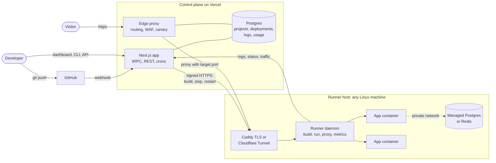

**Control plane.** Next.js 16 (App Router), tRPC, Prisma on PostgreSQL, NextAuth. Stateless: every long-running action is a `DeploymentJob` row that survives a function restart, and a cron resumes anything that lapses.

**Data plane.** The runner clones the repository, builds an image (the repo's Dockerfile, else a Syncbay-generated Dockerfile for the detected stack (§17), else Nixpacks), starts it on a host port, checks that it answers HTTP, and proxies traffic to it. Requests between the planes are signed (HMAC-SHA256, single-use nonce).

**Edge.** Every `*.syncbay.app` and custom-domain request enters through the Vercel proxy, which resolves the hostname to the live deployment and forwards to the runner.

## 5. Deploy lifecycle

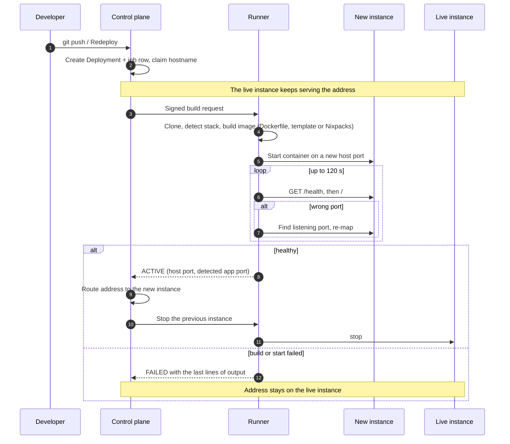

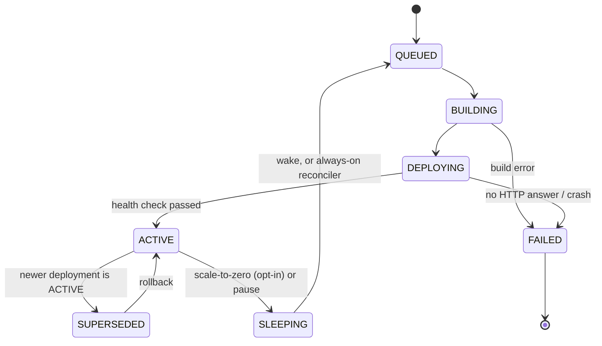

## 6. Functional requirements and status

Status: **Shipped** (in production code with a real test), **Partial**, **Planned**.

| Area (v0.1 §) | Requirement | Status | Notes |
| --- | --- | --- | --- |
| Identity (3.1) | GitHub, Google and password sign-in; workspaces; roles | Shipped | OWNER / ADMIN / MEMBER; invitations by email |
| Projects (3.2) | Projects, environments, PR preview environments | Shipped | Preview gets its own address, sleeps when idle, removed on PR close |
| Services (3.3) | GitHub-connected services; branch, root directory, build and start commands | Shipped | Push webhook triggers a deploy |
| Build (3.4) | Dockerfile and buildpack builds; clean rebuild | Shipped | **v1.5: generated Dockerfiles for Node, Next.js, Angular/React/Vue SPAs, static sites, Python, Go, Rust, PHP, Java, Ruby, Deno, Bun (§17)**; Nixpacks as a fallback; 2 builds at once |
| Deploy (3.5) | Health-checked releases, rollback, restart, pause | Shipped | **v1.3: zero-downtime; failed release leaves the live version up** |
| Deploy (3.5) | Canary releases with automatic rollback | Shipped | Uses real per-deployment 5xx counts |
| Network (3.6) | Generated subdomain and custom domains | Shipped | **v1.3: one owner per hostname** |
| Network (3.6) | Private service-to-database networking | Shipped | Same runner only (§7) |
| Network (3.6) | Private service-to-service networking; TCP proxy | Planned | §10 R-04 |
| Variables (3.7) | Per-service variables, `${{ service.VAR }}` references, secrets masked | Partial | Values not yet encrypted at rest (§10 R-03) |
| Databases (3.8) | One-click Postgres, Redis, MySQL; connection variables injected | Shipped | Query Studio for browsing and safe queries |
| Databases (3.8) | Backups and point-in-time restore | Planned | §10 R-02 |
| Storage (3.9) | Persistent volumes | Partial | Mounted and persistent; **browsable in the Data view (§18)**; size limit not enforced |
| Data (new) | See what is in databases, buckets and volumes; test their connections | Shipped | **v1.5 Data view (§18)** |
| Storage (3.9) | Object storage buckets | Shipped | Cloudflare R2; needs R2 keys configured |
| Observability (3.10) | Build and runtime logs, CPU/memory, traffic and latency | Shipped | Stored 30–35 days |
| Observability (3.10) | Crash detection and automatic restart | Shipped | **v1.5: health monitor probes every live app each minute and restarts it after two failures (§9.3)** |
| Observability (3.10) | Alerts on crash, error rate, resource limits (email, webhook) | Planned | §10 R-01 |
| Feature flags (3.11) | Flags per environment | Planned | Data model only |
| Billing (3.12) | Usage metering, spending cap, Stripe cards and invoices | Shipped | No card data touches Syncbay |
| API (3.13) | REST API with tokens, OpenAPI, CLI, GitHub webhooks | Shipped | |
| Templates (3.14) | One-click starters | Planned | |
| AI operations (3.15) | Failure diagnosis and tuning suggestions | Partial | Rule-based today; suggests, never applies |

## 7. Networking

### 7.1 Hostnames

Every service owns its addresses as rows in the `Domain` table, where the hostname is unique across the platform. The first service named `web` in `production` gets `web-production.syncbay.app`. A second one, in any workspace, gets `web-production-x7k2.syncbay.app`. Routing, sleeping and failure handling act only on a service's own rows.

### 7.2 Databases on the runner

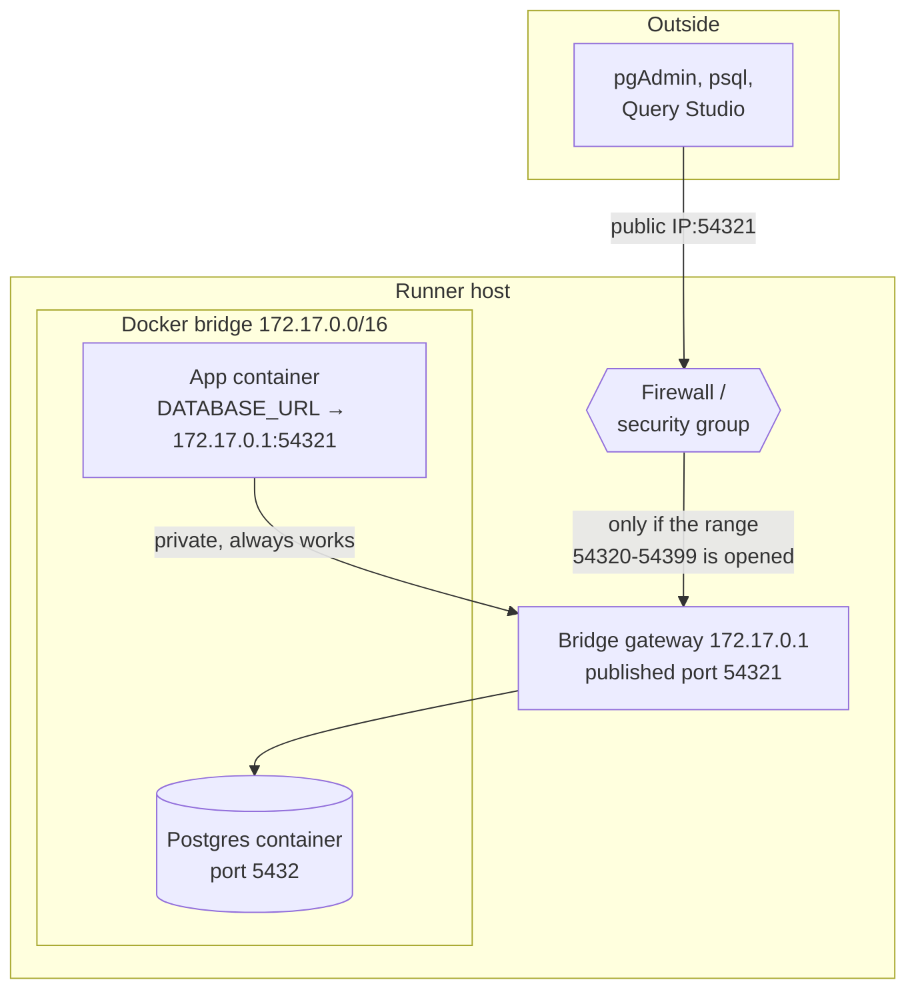

- The stored connection URL carries the runner's public address, for external tools.
- When the runner starts an app, it rewrites URLs that point at one of its own databases to the private address. Apps need no open port.
- External access is the operator's choice: open the database port range in the firewall, or leave it closed.
- **pgAdmin, DBeaver, psql from a laptop:** use an SSH tunnel (pgAdmin's *SSH Tunnel* tab, or `ssh -N -L 15432:127.0.0.1:<db-port> root@<runner>`). The database port stays closed.

## 8. Data model (core)

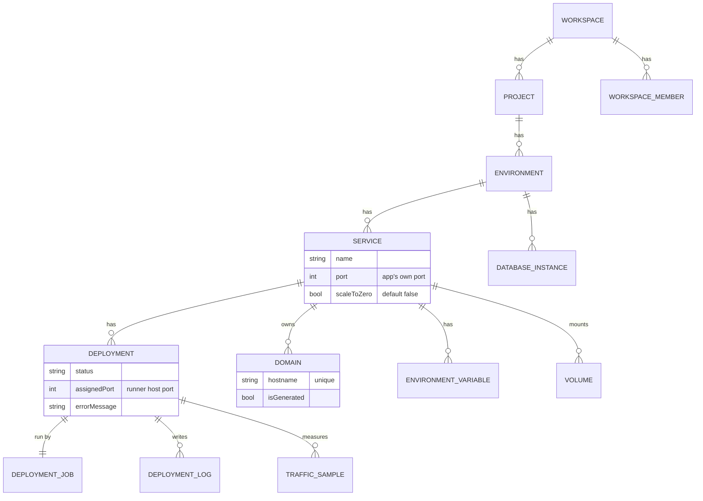

Two rules introduced in v1.3:

1. `Service.port` is the port the app listens on. `Deployment.assignedPort` is the host port the runner gave that instance. They are never copied into each other.
2. A hostname has exactly one owning service, recorded in `Domain`.

## 9. Incident review — November 2026

Reports from the first production users: *"my project goes to sleep"*, *"another tester's deploy fails"*, *"the database gives server errors"*. Investigation of the code and production logs found the following.

| # | Symptom | Root cause | Fix in v1.3 |
| --- | --- | --- | --- |
| 1 | Site shows "sleeping" | Scale-to-zero was the default, with a 5-minute idle timeout | Always-on by default; existing services switched; a cron starts sleeping always-on services |
| 2 | Site shows "sleeping" or "failed" although it runs | Every service named `portfolio` in `production` claimed `portfolio-production.syncbay.app`. One service sleeping or failing changed the shared address | One owner per hostname (§7.1) |
| 3 | Site unavailable during and after a redeploy | The address switched to the build page at the start of every deploy, and to "failed" if the new version failed | The live version keeps the address until the new one is healthy |
| 4 | "Health check failed … port 10000 within 10000ms" | (a) The engine saved the runner's host port as the service's app port, so the next deploy mapped the wrong container port. (b) 10 seconds was too short for many frameworks | Ports separated (§8); 120 s window; the runner finds the real port and re-maps |
| 5 | "Nixpacks build failed" with no visible cause | The error kept the first 4,000 characters of the build log; the cause is at the end. Unpinned projects built on Node 18 (end-of-life) | Error is the last 40 lines; Node 22 for unpinned projects |
| 6 | Database connection timeouts | Connection URLs used the server's public IP. From inside the same cloud host that path is blocked by the security group | Private address for apps on the runner (§7.2) |
| 7 | Database "unknown" after a runner update | The runner kept its list of databases in memory only | Rebuilt from Docker labels at start |
| 8 | Secrets visible in build logs | Environment values were written into `docker run` and `nixpacks` command lines | Values travel in the process environment; command lines carry names only |

Verified by: 8 deploy scenarios against a real Docker daemon, 7 availability checks against real Postgres and a runner process, and the existing lifecycle, project, observability and edge suites.

### 9.2 Production log review — 12 November 2026

After v1.3 went live, the Vercel runtime errors showed what was still wrong:

| Error | Cause | Fix in v1.4 |
| --- | --- | --- |
| `Health check failed … within 10000ms` after the release | The runner host had not been updated, so it still ran the old image | Operator action: update the runner (Appendix B) |
| `could not read Username for 'https://github.com'` from the cron | Deploys started by the cron or a webhook had no signed-in user, so private repositories were cloned without a token | A working GitHub token of the project's workspace is used; revoked tokens are cleared and skipped |
| GitHub `401` on the repository list | The leaked OAuth token had been revoked | The user is asked to sign in with GitHub again |
| `Nixpacks was unable to generate a build plan` | The always-on restart woke a legacy empty service; the starter app had no `package.json` | Starter app gets a `package.json`; always-on only restarts services with a source that were live in the last 30 days |
| `Task timed out after 300 seconds` on log streams | Server-sent event streams never ended on their own | Streams end after 270 s and the browser resumes from the last log line |
| pgAdmin `connection timeout` to the database port | The port is closed in the cloud firewall | Connect through an SSH tunnel; no port has to be opened (§7.2) |

Two security problems were found while designing the staff console and fixed first:

1. **Session cookies reached customer apps.** The login cookie is scoped to `.syncbay.app` so the wake button works on service hosts. The edge forwarded every request header, so a customer's app received the session token of everyone who visited it. Syncbay cookies are now removed before traffic is forwarded, at the edge and again in the runner.
2. **Password hashes in API responses.** Two workspace endpoints returned whole user rows (including `passwordHash` and `totpSecret`) to other members. They now return name, email and avatar only.

### 9.3 "502 Bad gateway" on a live site — 17 November 2026

A customer's site on `portfolio.syncbay.app` returned Cloudflare's *502 Bad gateway* although its deployment was ACTIVE.

| Finding | Evidence | Fix in v1.5 |
| --- | --- | --- |
| The runner host never received v1.3 or v1.4 | `/health` reported no `version`, uptime since 9 November | **Runner auto-updater** on the host (`updater` service): pulls `main` every 10 minutes and rebuilds the runner when its code changed; the result is on `/health` and the dashboard |
| The old runner mapped the wrong container port, so the proxy got "socket hang up" | Fixed in v1.3 code, still running on the host | Applied once the host updates |
| Nothing noticed that a live app stopped answering | No probe between deploys | **Health monitor** (every minute): two failed probes → restart in place, else redeploy the same build; cooldown, audit entry |
| Visitors saw a CDN error page | The runner answered 502 JSON | Browsers get a self-refreshing "restarting" page (HTTP 503) while an app is down |

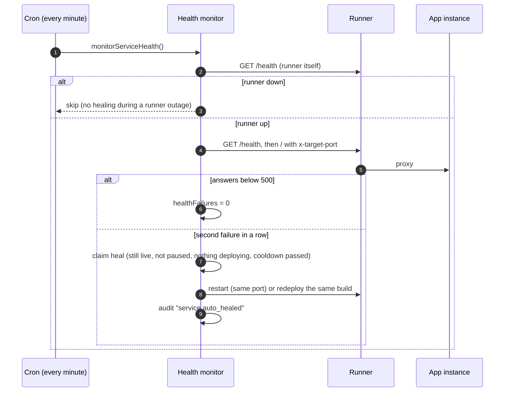

The Vercel runtime logs for 16–17 November showed no request errors; three cron runs could not reach the Prisma Postgres pool for a moment (transient, recovered on the next run).

## 10. Recommendations

Ordered by priority. Effort is engineering time for one developer.

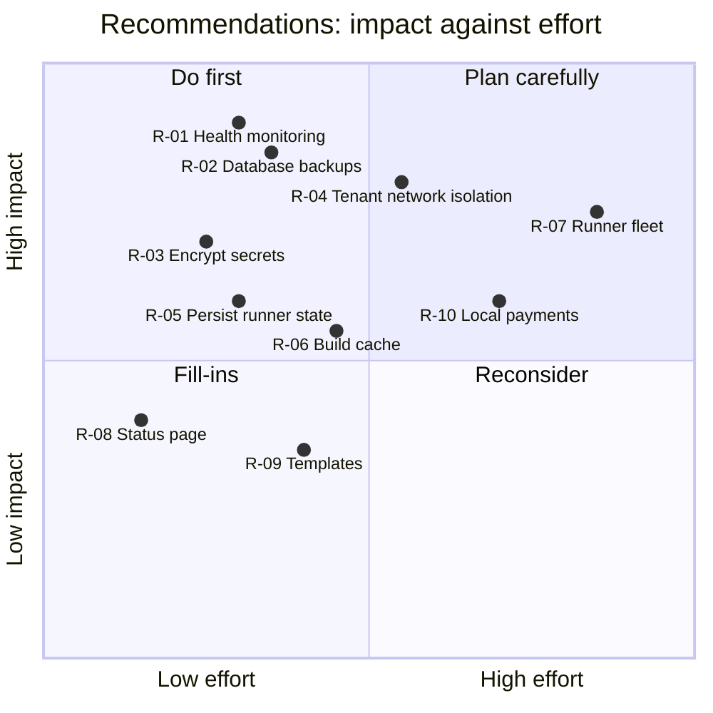

| ID | Recommendation | Why | Effort |
| --- | --- | --- | --- |
| **R-01** | **Alert on incidents.** Probing and automatic restart shipped in v1.5; still to do: email/webhook to the owner, CRASHED state after repeated heals, error-rate alerts | Owners should hear about a crash before visitors do | 2 days |
| **R-02** | **Database backups.** Nightly `pg_dump` to R2, 7-day retention, one-click restore | A single disk holds every customer database | 4–5 days |
| **R-03** | **Encrypt secrets at rest.** Envelope-encrypt `EnvironmentVariable.value` and database URLs with a key outside the database | A database leak would expose every customer secret | 2–3 days |
| **R-04** | **Isolate tenants on a runner.** One Docker network per environment; resource limits (`--memory`, `--cpus`, `--pids-limit`) per plan | Containers of different customers can reach each other and can starve the host | 5–7 days |
| **R-05** | **Persist runner state.** Launch specs and port allocations on disk | Restart and rollback currently fail after the runner itself restarts | 2–3 days |
| **R-06** | **Faster builds.** Per-service BuildKit cache; prebuilt base images on the runner; optional Railpack builder | A cold Nixpacks build spends 2–3 minutes downloading Nix packages | 4–5 days |
| **R-07** | **Runner fleet.** Several runners per region, capacity-aware placement, drain and migrate | One host is a single point of failure and a hard capacity limit | 3–4 weeks |
| **R-08** | **Public status page and uptime numbers** from the R-01 probes | Trust for paying customers; cheap once R-01 exists | 1–2 days |
| **R-09** | **Templates.** One-click Next.js, Express, FastAPI, Laravel with a database | Shortens time-to-first-deploy for new users | 3–4 days |
| **R-10** | **Local payment rails** (JazzCash, Easypaisa, bank transfer) | The regional pricing wedge from v0.1 §2.1 is untested without them | 2–3 weeks |
| **R-11** | **Least-privilege database access for the dashboard.** Provision a read-only role per managed database and use it for Query Studio and the Data view | Read mode now refuses dangerous statements and drops superuser rights, but a dedicated role is the real boundary | 2 days |
| **R-12** | **Sandbox builds.** Rootless Docker or a socket proxy for the runner; builds in a user namespace | Customer Dockerfiles build on the host's Docker daemon (§14) | 4–5 days |
| **R-13** | **Registry mirror and retry.** Pull-through cache for Docker Hub on each runner; one retry on 429/5xx | Docker Hub rate limits failed some cold builds during validation (§19) | 1 day |
| **R-14** | **Show the builder in the dashboard.** Report strategy and detected stack in the build status | Users should see "Built with the Syncbay Django template" | 0.5 day |

**Operational actions for the operator, outside the code:**

- Rotate the Cloudflare Tunnel token that was committed in `start-runner-services.ps1` (removed in v1.3, still in git history).
- Revoke GitHub OAuth tokens that appeared in build logs before v1.2.
- Keep only ports 22, 80 and 443 open on runner hosts; open 54320–54399 only if external database access is wanted.
- Set `CRON_SECRET`, `TERMINAL_TOKEN_SECRET` and the R2 keys in Vercel; without the R2 keys, buckets are disabled.

## 11. Non-functional requirements

| Requirement | Target | Current |
| --- | --- | --- |
| Time to first deploy | under 5 minutes from sign-in | Met: template builds take 4–106 s cold in validation (§19); cold Nixpacks builds take 4–6 minutes (R-06) |
| Redeploy downtime | none | Met since v1.3 |
| Failed release impact | none on the live version | Met since v1.3 |
| Service availability | 99.5 % per month on a single runner | Probed every minute since v1.5 (`lastHealthyAt`); monthly figure not yet reported (R-08) |
| Start-up window | configurable, default 120 s | Met |
| Secret handling | never in logs or command lines; encrypted at rest | Logs and commands met; at-rest encryption open (R-03) |
| Control-plane ↔ runner | signed, replay-proof | Met (HMAC-SHA256, single-use nonce) |
| Log retention | 30 days | Met |
| Recovery from control-plane restarts | no lost deploys | Met (job rows and cron recovery) |
| Accessibility | WCAG 2.2 AA on the dashboard | Not audited |

## 12. Roadmap

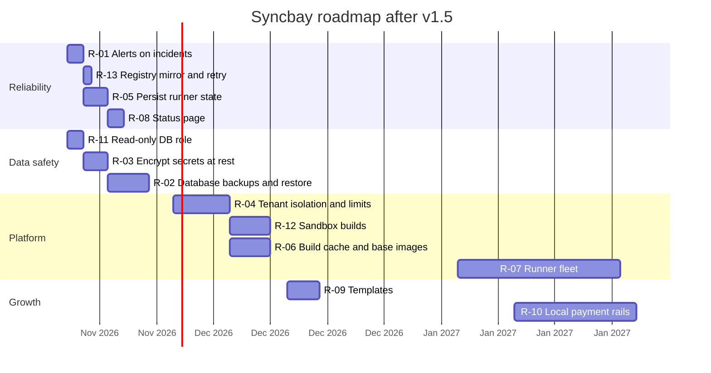

| Release | Theme | Exit criteria |
| --- | --- | --- |
| v1.5 (Nov 2026, this release) | Apps stay up; any stack builds | A crashed service restarts within 2–3 minutes; 11 stacks deploy without a Dockerfile; data is visible in the dashboard |
| v1.6 (Dec 2026) | Operate with confidence | Owners are alerted; nightly backups restore cleanly; secrets encrypted; dashboard DB access through a read-only role |
| v1.7 (Jan 2027) | Safe multi-tenancy | Tenants on one runner are network-isolated and resource-limited; builds sandboxed; warm builds under 90 seconds |
| v2.0 (Q1 2027) | Scale out and sell | Two or more runners with automatic placement; public status page; first paying workspaces on local payment rails |

## 13. Success metrics

| Metric | Definition | Target |
| --- | --- | --- |
| Time to first deploy | Median minutes from GitHub sign-in to a live URL | under 5 |
| Deploy success rate | Deployments reaching ACTIVE without a retry | above 90 % |
| Availability | Successful health probes / all probes, per service, per month | above 99.5 % |
| Redeploy downtime | Seconds the address answers non-2xx during a successful redeploy | 0 |
| Support load | Tickets per 100 deploys | under 2 |
| Cost-to-revenue | Infrastructure cost / billed usage | under 0.6 |
| Retention | Workspaces with a live service 30 days after first deploy | above 40 % |

## 14. Risks

| Risk | Impact | Mitigation |
| --- | --- | --- |
| A single runner host fails | All services on it are down | R-07 fleet; until then, nightly backups (R-02) and a documented rebuild |
| A tenant's container exhausts memory or disk | Other tenants degrade | R-04 limits; build concurrency cap is in place |
| Nixpacks is in maintenance mode upstream | Newer runtimes missing | Dockerfile path always available; evaluate Railpack (R-06) |
| Vercel function limits change | Long deploys stall | Deploys are job rows resumed by cron; no step depends on one long request |
| Secrets leak from the control-plane database | Customer breach | R-03; values already kept out of logs and command lines |
| Docker socket in the runner container | Runner compromise equals host compromise | Signed, replay-proof requests; only 443 exposed; repository files never followed through symlinks and runner secrets never passed to apps (v1.5, §19.3); R-12 |
| Docker Hub rate limits | Cold template builds fail | R-13 mirror; the live version keeps serving when a release fails |

## 15. Open questions

1. Is the first paying segment agencies with their own servers, or individuals on shared runners? It decides whether R-07 or R-10 comes first.
2. Should shared runners offer a free tier, and with what limits (R-04 is a prerequisite)?
3. Should Syncbay issue certificates for custom domains itself (Caddy on the runner) where Cloudflare SSL for SaaS is not available?
4. Which regions get the first additional runners?

## 16. Staff console (`/admin`)

Syncbay employees need one place to support customers, act on abuse and watch the business. Four research agents studied access control, customer 360 (CRM), trust and safety, and operations/ERP practice at Stripe, GitHub, Google, Vercel, Railway, Render, Cloudflare, HubSpot, Intercom, ChartMogul and others. v1 below is what shipped; §16.6 lists what is next.

### 16.1 Roles and permissions

| Permission | Super admin | Admin | Support | Moderator | Billing | Viewer |
| --- | --- | --- | --- | --- | --- | --- |
| Open console, overview, workspaces, users | ✓ | ✓ | ✓ | ✓ | ✓ | ✓ |
| Revenue (MRR, month to date) | ✓ | ✓ |  |  | ✓ | ✓ |
| Billing details of a workspace | ✓ | ✓ | ✓ |  | ✓ | ✓ |
| Notes on a customer | ✓ | ✓ | ✓ | ✓ | ✓ |  |
| Lifecycle stage and tags | ✓ | ✓ | ✓ |  | ✓ |  |
| Suspend / unsuspend a workspace | ✓ ✎ | ✓ ✎ |  | ✓ ✎ | ✓ ✎ |  |
| Suspend / unsuspend a user | ✓ ✎ | ✓ ✎ |  | ✓ ✎ |  |  |
| Take down / restore a service | ✓ ✎ | ✓ ✎ |  | ✓ ✎ |  |  |
| Abuse queue: read | ✓ | ✓ | ✓ | ✓ |  | ✓ |
| Abuse queue: assign, resolve | ✓ | ✓ |  | ✓ |  |  |
| Staff list; grant Support/Moderator/Billing/Viewer | ✓ | ✓ |  |  |  |  |
| Grant or revoke Admin / Super admin | ✓ ✎ |  |  |  |  |  |
| Audit log | all | all | own | own | own |  |

✎ = needs a written reason; destructive actions also need the target's name typed. Nobody can see environment variable values, database passwords or OAuth tokens.

### 16.2 How access is enforced

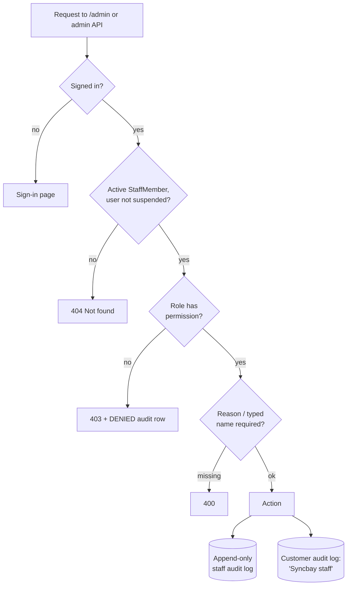

- Roles are read from the database on every request, so revoking access works at once.
- `SUPER_ADMIN_EMAILS` bootstraps the first super admins. It only counts for an account signed in with GitHub or Google (an email the provider verified), never a password-only account. Such admins cannot be revoked from the console.
- The last super admin cannot be removed: the check runs under a database lock.
- The staff audit log is append-only. A database trigger rejects updates and deletes.

### 16.3 Moderation

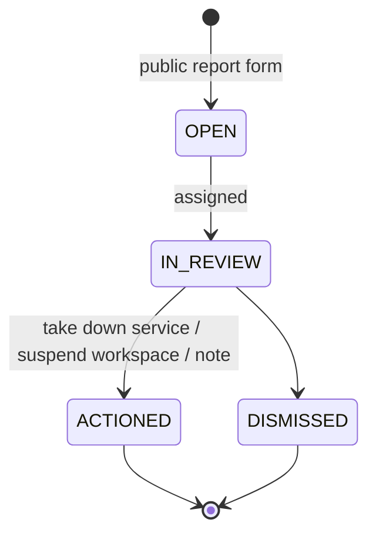

- **Public form:** `/report-abuse` needs no login. It is protected by a honeypot, a minimum time on the form, a per-IP limit and de-duplication.
- **Linking and priority:** a report is linked to the service that serves the reported host. Priority comes from the category: CSAM, phishing and malware first, copyright last.
- **Take down vs pause:** a take-down stops the service and sets a lock that the owner cannot lift (unlike their own pause).
- **Suspension** stops every service in the workspace. While it lasts, deploys fail with an explanation, and resume and wake are refused. The always-on restart skips the workspace, and API tokens are rejected.
- **Suspended users** can't sign in. Their sessions are refused within 30 seconds.

### 16.4 Customer 360

- **Search** accepts an email, workspace slug, service hostname, Stripe customer id or raw id.
- **The workspace page shows:**
  - owner and members;
  - projects and services, with the latest deployment, domains and variable *names*;
  - databases (name and status only);
  - billing and month-to-date usage (billing roles only);
  - abuse reports, the customer's audit log, and pinned notes;
  - lifecycle stage and tags.

### 16.5 Data model

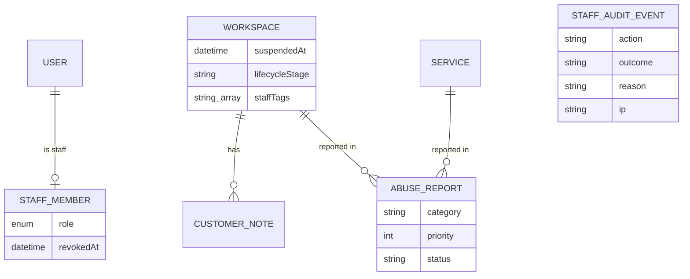

### 16.6 Next for the console

| Priority | Item | Why |
| --- | --- | --- |
| 1 | Separate staff session (own host-only cookie, 8 h / 30 min idle) and passkeys for staff | Staff access should not ride on the customer session |
| 2 | "Suspended" page on the service hostname and customer emails with a statement of reasons; appeals | Customers and visitors should know what happened and how to appeal |
| 3 | Runner host registry with monthly cost; gross margin; capacity | ERP view of infrastructure cost vs revenue |
| 4 | Dunning queue, credits and refunds through Stripe with two-person approval over $500 | Billing operations without the Stripe dashboard |
| 5 | Automatic signals: Google Web Risk on new hosts, crypto-mining detection, brand words in new hostnames | Find abuse before reports arrive |
| 6 | CSV exports, saved views, assigned account managers | Day-to-day CRM work |
| 7 | Consent-based read-only impersonation (1 hour, customer notified) | Faster support without broad access |

## 17. Build any common stack (v1.5)

Most repositories have no Dockerfile. Until v1.4 they depended on Nixpacks, which is slow on a cold runner (2–3 minutes downloading Nix packages), needs ghcr.io, and is in maintenance mode upstream. v1.5 adds a Syncbay builder: the runner reads the repository's manifests and writes `Dockerfile.syncbay` from official Docker Hub images.

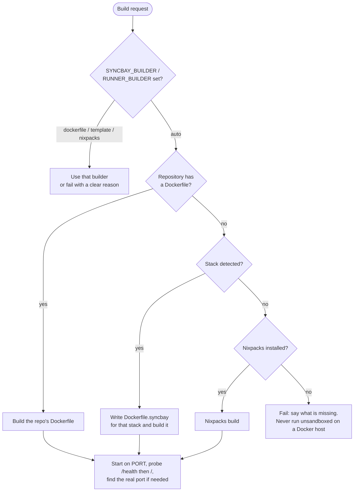

| Stack | Detected from | Image | Verified end to end |
| --- | --- | --- | --- |
| Node.js (Express, Nest, Fastify …) | `package.json`, or a lone `server.js`/`index.js` | `node:22-bookworm-slim` | Express |
| Next.js, Nuxt, Remix, SvelteKit, Astro | framework dependency | `node:22` | Next.js 15 |
| Angular, React (Vite/CRA), Vue, Svelte | SPA build tooling | build in `node`, serve with `nginx:1.27-alpine` (SPA fallback) | Angular 19, React + Vite |
| Static site | `index.html` | `nginx:1.27-alpine` | plain HTML |
| Python: Flask, FastAPI, Django, Procfile | `requirements.txt`, `pyproject.toml`, Poetry, uv, Pipenv | `python:3.12-slim` + gunicorn/uvicorn | Flask, FastAPI, Django |
| Go | `go.mod` | `golang` → `debian-slim` | net/http |
| Rust | `Cargo.toml` | `rust` → `debian-slim` | std server |
| PHP, Laravel | `composer.json`, `index.php`, `artisan` | `php:8.3-apache` | Composer app |
| Java (Maven, Gradle) | `pom.xml`, `build.gradle` | Temurin JDK → JRE | unit tests only |
| Ruby (Rack, Rails) | `Gemfile` + `config.ru` | `ruby:3.3-slim` | unit tests only |
| Deno, Bun | `deno.json`, `bun.lock` | `denoland/deno`, `oven/bun` | unit tests only |

Rules the builder keeps:

- Every image listens on `$PORT` on `0.0.0.0`; the service's build and start commands replace the defaults.
- User files are never overwritten; generated files never follow a symlink the repository planted (§19.3).
- Proxy variables reach `docker build` by name only; a corporate CA (`RUNNER_BUILD_CA_FILE`) is trusted in every downloading stage and removed after the build.
- A failed template build is not retried with Nixpacks (it would double the build time); the error names `SYNCBAY_BUILDER=nixpacks` and "add a Dockerfile" as the ways out.

## 18. Data view (v1.5)

Customers asked to *see* what their services store. Every project now has a **Data** page (`/dashboard/projects/:id/data`), linked from the project, Databases and Buckets pages.

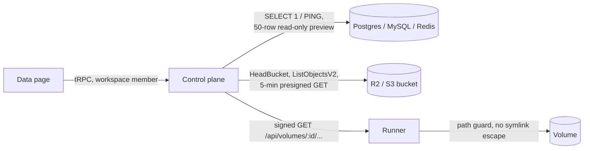

| Resource | Test connection | Browse | Limits and access |
| --- | --- | --- | --- |
| Database | `SELECT 1` / `PING` + server version, runner health; unreachable and auth hints (incl. the `ssh -N -L` tunnel) | tables and columns, 50-row preview; Redis key types and values | read-only, 10 s timeout, values over 64 KiB cut; viewers see structure only |
| Bucket | HeadBucket + list one object | folders, objects, pagination, download | download links last 5 minutes; viewers cannot download or upload |
| Volume | runner stat | directories, text preview up to 64 KiB, binary type and size | `..`, absolute paths, NUL, FIFOs, devices and symlinks leaving the volume are refused; viewers cannot open files |

## 19. Validation and security review (v1.5)

Three agents tested the release independently: a deploy matrix through the real control-plane path, a security audit of the new surfaces, and a code review of the whole diff. Every confirmed finding was fixed before merge and has a regression test.

### 19.1 Deploy matrix

Each project was a git repository without a Dockerfile, deployed through `scheduleDeployment()` → engine → signed webhook → a real runner daemon → Docker, and fetched through the runner proxy as a visitor would. Cold rebuilds used `--no-cache`.

| Stack | ACTIVE | Builder | HTTP 200 via proxy | Secret in logs or image | Cold rebuild |
| --- | --- | --- | --- | --- | --- |
| Express | yes | template | yes | no | 12 s |
| Next.js 15 | yes | template | yes | no | 52 s |
| React + Vite (deep route) | yes | template | yes | no | 20 s |
| Static HTML | yes | template | yes | no | 36 s |
| Flask | yes | template | yes | no | 34 s |
| FastAPI | yes | template | yes | no | 42 s |
| Django | yes | template | yes | no | 54 s |
| Go net/http | yes | template | yes | no | 20 s |
| Rust std | yes | template | yes | no | 92 s |
| PHP | yes | template | yes | no | 62 s |
| Angular 19 (deep link) | yes | template | yes | no | 106 s |

Also verified: a fast redeploy answered 28 of 28 probes with HTTP 200 while switching versions; a failed rebuild left the live version serving; `docker kill` of a live app was healed by the health monitor in two cron runs; a deploy handed off by the 240 s poll budget was resumed by the recovery cron and went ACTIVE; a Python app that crashes on import failed with its own traceback.

### 19.2 Test suites

All five merge gates (prisma generate, typecheck, knip, lint, build) pass, and so do the runner unit tests, the real-Docker runner suites (deploys, stacks, database provisioning) and the control-plane suites `test:deploy`, `test:availability`, `test:data`, `test:query`, `test:observe`, `test:projects`, `test:admin`, `test:domains`, `test:analytics`, `test:billing`, `test:r2`, `test:devops`, `test:terminal-stateless` against real Postgres, Redis, runner daemons, Docker and an S3-compatible store.

### 19.3 Security findings fixed in this release

| Severity | Finding | Fix |
| --- | --- | --- |
| Critical | A repository could plant symlinks (`Dockerfile.syncbay`, `.dockerignore`, the CA file) so the root runner overwrote host files or copied its own environment into the image | Runner-owned files are written with `O_EXCL` after removing the entry; repo files are read with `O_NOFOLLOW`, regular and in-tree only |
| Critical | A repository with no recognised stack ran as a native host process with the runner's secrets in its environment | Refused on Docker hosts with a clear message; native processes never inherit `RUNNER_*`/`SYNCBAY_*`/cloud credentials; a lone `server.js` is now built in a container |
| High | `rootDir` could point outside the repository | Validated in the API and again on the runner (no `..`, absolute paths or symlinked escapes) |
| High | A FIFO in a volume froze the runner daemon | Only regular files are opened, non-blocking |
| High | Viewers received database passwords and could mint bucket upload links | Masked for viewers; presigned URLs need MEMBER or above |
| High | The health monitor could resume a service paused during a probe, or put an old build over a new release | The heal claim re-checks the service's state |
| High | Healthy apps could be restarted every 15 minutes (SSH/simulated runners, apps whose `/` returns 5xx) | Probe `/health` then `/`; skip modes without a probe path |
| Medium | Query Studio read mode on a superuser connection could run `COPY … TO PROGRAM` or read server files | Statement allowlist, dangerous functions refused, `SET LOCAL ROLE pg_read_all_data`; R-11 for a dedicated role |
| Medium | Huge values were returned whole (20 MB) | Values capped at 64 KiB |
| Medium | Updates could cut in-flight builds | The updater builds first and waits until the runner is idle |
| Low | Manifest values could inject Dockerfile lines; URL masking edge cases; Redis key names visible to viewers; a malformed `%`-escape could stop the daemon; resumed deploys duplicated their log; ports busy on 0.0.0.0 were handed out | All fixed |

## Appendix A — Runner settings added in v1.3

| Variable | Default | Purpose |
| --- | --- | --- |
| `RUNNER_HEALTH_TIMEOUT_MS` | 120000 | Time a new instance has to answer HTTP |
| `RUNNER_MAX_CONCURRENT_BUILDS` | 2 | Image builds running at once |
| `RUNNER_DEFAULT_NODE_VERSION` | 22 | Node major for Nixpacks projects that pin none |
| `RUNNER_DB_PORT_RANGE` | shared range | Host ports for databases, e.g. `54320-54399` |
| `RUNNER_DB_INTERNAL_HOST` | Docker bridge gateway | Address apps use to reach databases on the runner |

## Appendix B — Updating a runner

Once, by hand (this also starts the auto-updater):

```bash
cd /opt/syncbay && git pull && docker compose -f deploy/alibaba-ecs/docker-compose.yml up -d --build
curl -fsS https://runner.syncbay.app/health   # "version": "1.5.0"
```

After that the `updater` service pulls `main` every 10 minutes, builds the new runner image, waits until no deploy is building, then swaps the runner. Docker apps and Docker databases keep running; apps and databases running as native processes inside the runner container restart with it. `RUNNER_AUTO_UPDATE=false` turns it off.

## Appendix C — Settings added in v1.4

| Variable | Where | Purpose |
| --- | --- | --- |
| `SUPER_ADMIN_EMAILS` | Vercel | Emails that are always super admin (GitHub or Google sign-in required) |

## Appendix D — Settings added in v1.5

| Variable | Where | Default | Purpose |
| --- | --- | --- | --- |
| `SYNCBAY_BUILDER` | service variable | `auto` | `auto`, `template`, `nixpacks` or `dockerfile` for one service |
| `RUNNER_BUILDER` | runner host | `auto` | Same, for every service on the runner |
| `RUNNER_BUILD_CA_FILE` | runner host | none | CA bundle that build steps trust (corporate or egress proxy) |
| `RUNNER_BUILD_NETWORK` | runner host | default | `host` runs `docker build --network host` |
| `RUNNER_VOLUME_ACCESS` | runner host | `auto` | How the Data view reads Docker volumes: `direct` (mountpoint) or `container` (read-only helper) |
| `RUNNER_VOLUME_HELPER_IMAGE` | runner host | `busybox:1.36.1` | Image of that helper |
| `SYNCBAY_REPO_DIR`, `RUNNER_AUTO_UPDATE`, `RUNNER_AUTO_UPDATE_INTERVAL` | runner host `.env` | `/opt/syncbay`, `true`, `600` | Auto-updater |
